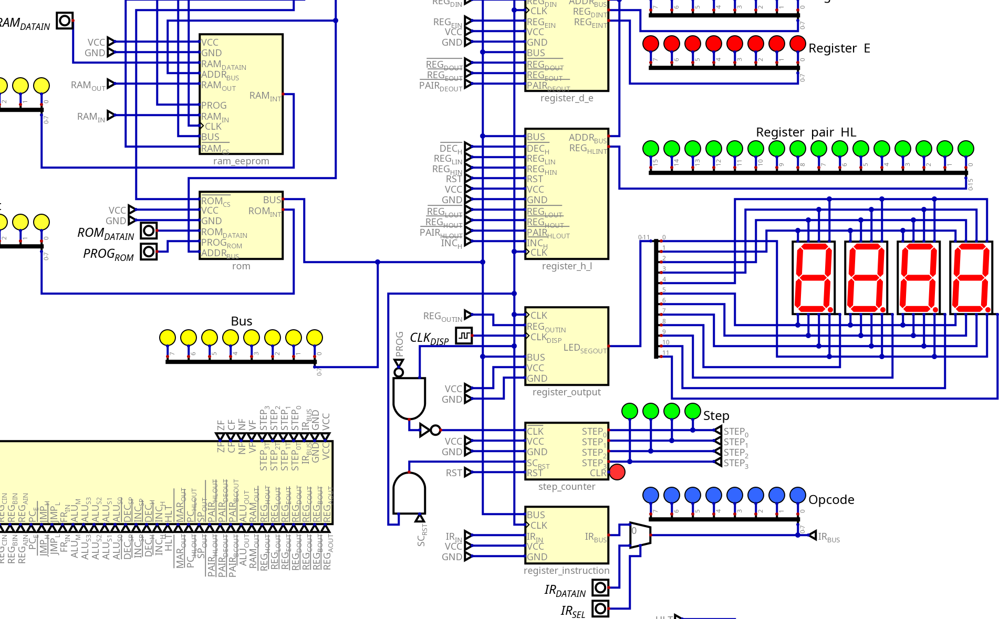
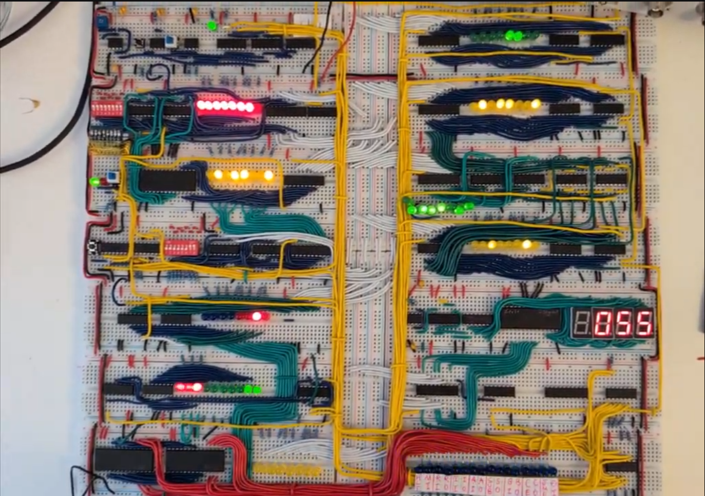
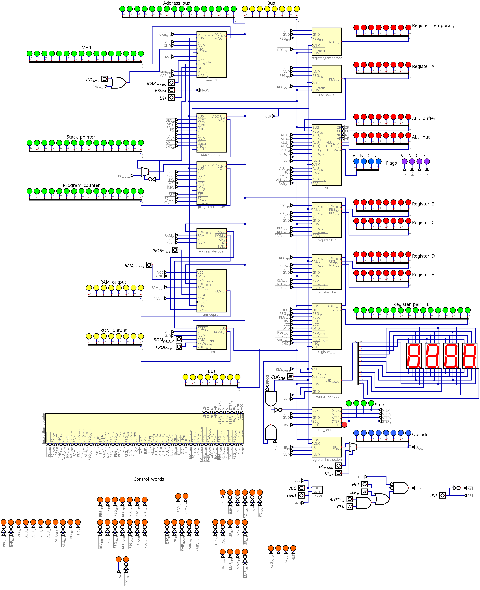
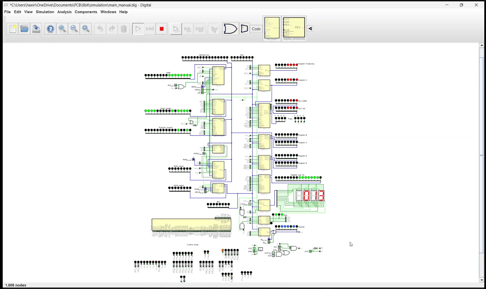

# 8bit
8-bit SAP-3 inspired architecture using 74xx series logic chips.

## Files
KiCad design files can be found under `schematic/`, clone and open `8bit.kicad_pro`.  
Schematic PDF is under `schematic/pdf/`.  

Simulation files for Digital can be found under `simulation/`.  
The hex files to program EEPROMs are under `simulation/hex/`.  

Python code to generate ucode bin files is under `code/`, run the `code/generate_roms.py` to generate the files.  

A simple assembly code is under `code/exmaples/`.  

## Simulation
The project uses the `hneemann/Digital` [Digital](https://github.com/hneemann/digital) simulator.  
Open the `main_manual.dig` in Digital to view the simulation.  
  
Run the simulation and click on the AUTO_EN input for the clock to tick automatically, or you can also click the clock to pulse it manually.  

## Features
- 8 bit wide data bus
- 16 bit wide address bus
- 8 bit A/B/C/D/E/H/L/temporary registers
- BC, DE, HL can pair up to become a 16 bit wide register
- 32k RAM
- Memory-Mapped IO
- 16 bit stack pointer, memory address register, program counter
- 8080-like instruction set
- CompactFlash read/write
- LCD output

## Demo
1.  (Video) A simplified SAP-1 version running fibonacci sequence code.

2. SAP-3 in simulation

3. (Video) SAP-3 running fibonacci code

